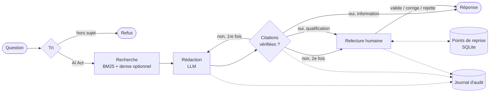

# AI Act Assistant

[](https://github.com/YannisBouharaoua/ai-act-assistant/actions/workflows/ci.yml)

Un agent qui répond aux questions de conformité sur le règlement européen sur l'intelligence
artificielle (AI Act, règlement (UE) 2024/1689). Chaque réponse cite ses articles, les citations
sont vérifiées par du code, et toute qualification d'un système passe par un relecteur humain.

Le projet montre comment encadrer un modèle de langage dans un contexte réglementé :
le modèle rédige, mais il ne décide pas seul et tout ce qu'il fait est tracé.

## Ce que fait l'agent

| Situation | Comportement |
|---|---|
| Question sur le texte (« Combien de temps conserver les journaux ? ») | Réponse rédigée à partir des articles retrouvés, avec citations `[Article 26]` |
| Citation d'un article absent des extraits retrouvés | Nouvelle rédaction avec la correction, puis relecture humaine si l'erreur persiste |
| Description d'un système à qualifier (« Notre outil trie des candidatures ») | Proposition de niveau de risque, **mise en attente** jusqu'à la décision d'un relecteur |
| Question hors sujet | Refus, sans recherche ni rédaction |

## Architecture



Le graphe est écrit avec [LangGraph](https://github.com/langchain-ai/langgraph). Trois choix
structurent le projet :

- **La vérification des citations n'est pas confiée au modèle.** Une expression régulière extrait
  les références citées et les compare aux extraits réellement fournis. C'est déterministe,
  gratuit et testable.
- **La relecture humaine est une interruption du graphe, pas une file d'attente à part.**
  L'état est sauvegardé dans SQLite : le relecteur peut répondre plus tard, même après un
  redémarrage du service. Tant qu'il n'a pas validé, le demandeur ne voit pas le brouillon.
- **Le fournisseur de modèle est interchangeable.** Le graphe ne connaît qu'une interface
  `LLM.complete`. Anthropic et Azure OpenAI sont fournis, ainsi qu'un modèle factice
  déterministe pour les tests.

Le détail est dans [docs/architecture.md](docs/architecture.md), et les raisons de chaque choix
dans les [fiches de décision](docs/adr/).

## Démarrage rapide

Sans clé d'API, avec le modèle factice et l'extrait de démonstration :

```bash
git clone https://github.com/YannisBouharaoua/ai-act-assistant.git
cd ai-act-assistant
python -m venv .venv && source .venv/bin/activate
pip install -e ".[dev]"

ai-act ask "Quelle est l'amende maximale en cas de pratique interdite ?"
```

```text
[answered] conversation 3f9c…
Le non-respect de l'interdiction des pratiques visées à l'article 5 fait l'objet d'amendes
administratives pouvant aller jusqu'à 35 000 000 EUR ou, pour une entreprise, jusqu'à 7 % de
son chiffre d'affaires annuel mondial, le montant le plus élevé étant retenu. [Article 99]

Cette réponse est une aide à la lecture du règlement et ne constitue pas un avis juridique.
  - Article 99 — Sanctions
```

Le modèle factice ne rédige pas : il recopie la phrase des extraits qui partage le plus de
mots avec la question, et il se trompe donc souvent de phrase. Il sert à faire tourner tout le circuit (tri, recherche, vérification, relecture,
audit) sans réseau. Pour de vraies réponses, branchez un fournisseur.

### Avec un vrai modèle

```bash
cp .env.example .env
pip install -e ".[anthropic]"      # ou ".[azure]"
```

Puis dans `.env` :

```ini
LLM_PROVIDER=anthropic             # ou azure_openai
ANTHROPIC_API_KEY=...
REVIEWER_API_KEY=une-cle-longue-et-aleatoire
```

### Avec le texte complet du règlement

L'extrait fourni dans `data/sample/` contient 11 articles résumés, pour les tests. Pour charger
le texte officiel en français depuis EUR-Lex :

```bash
pip install -e ".[fetch]"
python scripts/fetch_corpus.py
echo "CORPUS_PATH=data/corpus/ai_act_fr.txt" >> .env
ai-act corpus
```

### Avec Docker

```bash
cp .env.example .env
docker compose up --build
```

## API

```bash
ai-act serve          # http://127.0.0.1:8000/docs
```

| Route | Public | Rôle |
|---|---|---|
| `POST /ask` | demandeur | Pose une question. Renvoie `answered`, `refused` ou `pending_review` |
| `GET /threads/{id}` | demandeur | Relit le résultat, par exemple après une relecture |
| `GET /reviews/{id}` | relecteur | Lit le brouillon, les sources et le motif de la relecture |
| `POST /reviews/{id}` | relecteur | Décide : `approve`, `edit` (avec la réponse corrigée) ou `reject` |
| `GET /audit/{id}` | relecteur | Journal complet de la conversation |
| `GET /health` | tous | État du service, modèle utilisé, taille du corpus |

Les routes du relecteur exigent l'en-tête `X-Reviewer-Key`.

Exemple d'une qualification, de la question à la validation :

```bash
curl -s -X POST localhost:8000/ask -H 'content-type: application/json' \
  -d '{"question": "Notre outil trie les candidatures pour le recrutement, est-il à haut risque ?"}'
# → {"thread_id": "e51e…", "status": "pending_review", "answer": null,
#    "review_reason": "qualification_d_un_systeme", …}

curl -s localhost:8000/reviews/e51e… -H 'X-Reviewer-Key: …'
# → le brouillon, les extraits lus, les citations

curl -s -X POST localhost:8000/reviews/e51e… -H 'X-Reviewer-Key: …' \
  -H 'content-type: application/json' \
  -d '{"decision": "approve", "reviewer": "juriste@exemple.fr"}'
# → {"status": "answered", "citations": ["Annexe III", "Article 6"], …}
```

## Journal d'audit

Chaque étape écrit une ligne JSON dans `var/audit.jsonl`. Pour une conversation, on peut
reconstituer ce qui a été lu, ce qui a été rédigé, ce qui a été vérifié et qui a validé :

```json
{"ts": "…", "thread_id": "e51e…", "event": "question_received", "question": "Notre outil…"}
{"ts": "…", "thread_id": "e51e…", "event": "routed", "route": "qualification"}
{"ts": "…", "thread_id": "e51e…", "event": "retrieved", "chunk_ids": ["annexe-iii", "article-6"]}
{"ts": "…", "thread_id": "e51e…", "event": "llm_call", "task": "qualify", "model": "…", "duration_ms": 840}
{"ts": "…", "thread_id": "e51e…", "event": "citations_checked", "cited": ["Annexe III", "Article 6"], "unverified": [], "ok": true}
{"ts": "…", "thread_id": "e51e…", "event": "review_requested", "reason": "qualification_d_un_systeme"}
{"ts": "…", "thread_id": "e51e…", "event": "human_review", "decision": "approve", "reviewer": "juriste@exemple.fr"}
{"ts": "…", "thread_id": "e51e…", "event": "answered", "status": "answered", "citations": ["Annexe III", "Article 6"]}
```

## Tests et qualité

```bash
make test     # 30 tests, hors ligne, moins de 2 secondes
make lint     # ruff
make eval     # qualité de la recherche sur 16 questions de référence
```

Les tests couvrent le découpage du texte, la recherche, chaque branche du graphe (réponse
directe, nouvelle rédaction après une citation inventée, relecture, correction, rejet),
l'API, les droits du relecteur et la reprise d'une relecture après redémarrage.

`make eval` mesure la recherche seule, sur l'extrait de démonstration :

| Mesure | Valeur | Lecture |
|---|---|---|
| `hit_rate` à k = 4 | 1.00 | L'article attendu figure toujours dans les 4 extraits |
| `mrr` | 0.93 | Il est presque toujours en première position |

La CI échoue si `hit_rate` passe sous 0.9. Ces chiffres valent pour 11 articles : ils servent
de filet contre les régressions, pas de preuve de qualité sur le règlement complet.

## Limites

À lire avant toute réutilisation : [docs/limites.md](docs/limites.md). En résumé :

- les fournisseurs Anthropic et Azure OpenAI ne sont pas couverts par les tests automatiques ;
- la qualité des réponses rédigées n'est pas encore mesurée, seule la recherche l'est ;
- le journal d'audit contient les questions en clair, donc potentiellement des données
  personnelles ;
- ce projet est une aide à la lecture du règlement, pas un avis juridique.

## Structure

```text
src/ai_act_assistant/
  corpus.py      découpage du règlement par article, extraction des citations
  retriever.py   recherche BM25, index dense optionnel, fusion des classements
  llm.py         interface LLM, Anthropic, Azure OpenAI, modèle factice
  prompts.py     instructions données au modèle
  graph.py       graphe LangGraph : tri, recherche, rédaction, vérification, relecture
  service.py     façade : poser une question, relire, reprendre
  api.py         API FastAPI
  audit.py       journal d'audit en ajout seul
  evaluate.py    mesure de la recherche
tests/           30 tests hors ligne
eval/            questions de référence
docs/            architecture, fiches de décision, limites
```

## Licence

MIT. Le texte du règlement appartient à l'Union européenne et sa réutilisation est autorisée
sous réserve d'en citer la source (EUR-Lex).
