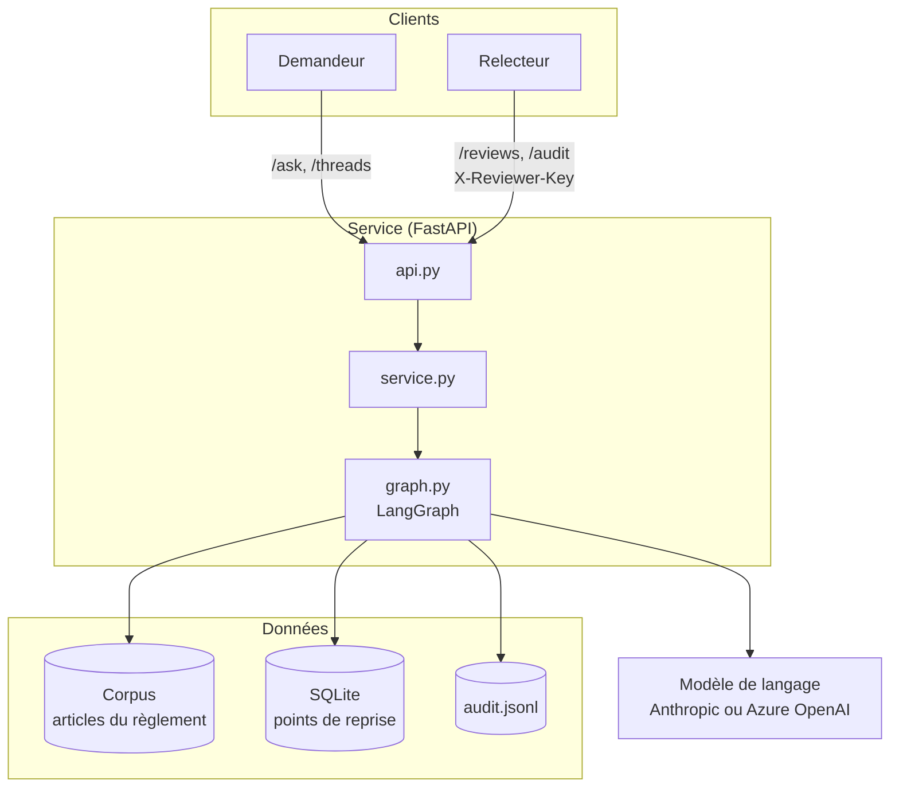

# Architecture

## Vue d'ensemble

Le service tient dans un seul processus. Il n'y a ni base vectorielle ni file de messages :
le corpus fait quelques centaines d'extraits et se réindexe en mémoire au démarrage.

## Le parcours d'une question

| Étape | Nœud du graphe | Qui décide | Écrit dans l'audit |
|---|---|---|---|
| 1. Tri | `route_question` | Modèle (sortie JSON) | `question_received`, `routed` |
| 2. Recherche | `retrieve` | Code (BM25, dense optionnel) | `retrieved` |
| 3. Rédaction | `generate` | Modèle | `llm_call` |
| 4. Vérification | `verify` | Code (expression régulière) | `citations_checked` |
| 5. Relecture | `human_review` | Humain | `review_requested`, `human_review` |
| 6. Réponse | `finalize` | Code | `answered` |

Le modèle intervient à deux endroits seulement, le tri et la rédaction. Les deux étapes de
contrôle, la vérification et la relecture, ne dépendent pas de lui.

### Quand le tri se trompe

Si la sortie du tri est illisible, la question est traitée comme une demande d'information.
C'est le chemin le moins risqué : la réponse reste soumise à la vérification des citations.
Une question classée à tort en « information » alors qu'elle décrit un système échappe en
revanche à la relecture obligatoire. C'est la principale faiblesse du circuit, décrite dans
[limites.md](limites.md).

### La vérification des citations

Le modèle doit citer ses sources sous la forme `[Article N]` ou `[Annexe N]`. Après la
rédaction, le code :

1. extrait toutes les références citées ;
2. les compare aux références des extraits fournis au modèle ;
3. en cas d'écart, ou en l'absence de toute citation, renvoie le brouillon au modèle avec la
   correction à faire ;
4. au deuxième échec, envoie le brouillon en relecture humaine.

Cette vérification garantit qu'une référence citée a bien été lue. Elle ne garantit pas que
la phrase qui la précède est fidèle à l'article.

### La relecture humaine

Le nœud `human_review` appelle `interrupt()`. LangGraph sauvegarde alors l'état de la
conversation dans SQLite et rend la main. L'API répond `pending_review`, sans le brouillon.

Quand le relecteur envoie sa décision, le graphe reprend au même nœud. LangGraph rejoue le
nœud depuis son début : tout ce qui précède `interrupt()` doit donc être sans effet de bord.
C'est pourquoi l'événement `review_requested` est écrit par la couche service, et non dans
le nœud.

## Le découpage du corpus

Le règlement est découpé par article et par annexe. Un article trop long est coupé entre
deux paragraphes, et chaque morceau garde la référence de l'article. Cette règle sert
directement la vérification : un extrait correspond toujours à une référence citable.

## La recherche

Par défaut, la recherche est lexicale (BM25), après mise en minuscules, retrait des accents
et des mots vides, et réduction des pluriels simples. Un extrait qui ne partage aucun mot
avec la question n'est jamais renvoyé.

Avec `DENSE_MODEL` défini, un index d'embeddings est ajouté et les deux classements sont
fusionnés par Reciprocal Rank Fusion. Cette fusion compare des rangs et non des scores : elle
évite d'avoir à étalonner deux échelles différentes.

## Sécurité

| Risque | Mesure en place |
|---|---|
| Lecture d'un brouillon non validé | Le brouillon n'est renvoyé que sur `/reviews`, protégé par clé |
| Consigne cachée dans la question ou le corpus | Les instructions demandent au modèle de traiter extraits et question comme des données. La vérification des citations et la relecture limitent les effets d'un contournement |
| Clé du relecteur devinée par mesure du temps de réponse | Comparaison en temps constant |
| Fuite de secrets | Clés lues dans l'environnement, `.env` exclu du dépôt |
| Conteneur compromis | Le service tourne avec un utilisateur sans privilèges |

Ce qui manque est listé dans [limites.md](limites.md).
